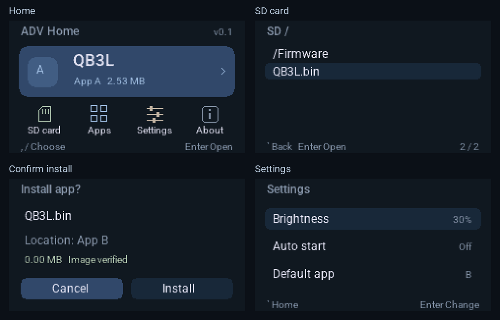

# ADV Home

**English** | [简体中文](README.zh-CN.md)

A lightweight launcher for **M5Stack Cardputer ADV / ESP32-S3 / 8 MB Flash**, with SD card firmware installation, two application slots and optional automatic startup.

The device displays **v0.1**. The corresponding Git tag is **v0.1.0**. The English interface uses Roboto Regular for text and Roboto Medium for headings.

The preview is generated from the framebuffer of the actual UI code.

## Features

- Browse files and folders on a microSD card, inspect images and install compatible ESP32-S3 firmware.
- Manage two application slots, A and B, with **3 MiB per slot**. Run, replace or remove an application.
- Configure the default application, an optional 3-second startup countdown and screen brightness.
- Press any key during the countdown to stay in Home. Automatic startup is skipped after an abnormal reset.
- Validate the image format, target chip, checksum and appended SHA-256 before installation, then read back and verify the installed image.
- Store Home settings separately and use a one-shot request to select the application at boot.

## Download and installation

Download the [v0.1 release bundle](https://github.com/fineuralab/adv-home/releases/tag/v0.1.0) or [build it from source](#build-and-test). When sharing a standalone binary, include the matching third-party-notices ZIP.

| File | Flash address | Use |
|---|---|---|
| ADV-Home-v0.1_0x0.bin | 0x0 | First installation or switching from another launcher |
| ADV-Home-v0.1-update_0x10000.bin | 0x10000 | Updating an existing ADV Home N1 / N1.1 / N1.2 installation while preserving its applications and settings |

The full image resets the application slots and configuration in Flash. Files on the microSD card are preserved. **Use the correct address for each file.** The application-only update requires the existing ADV Home partition layout.

The [detailed installation guide (简体中文)](docs/INSTALL.md) covers download mode, the web flasher, microSD installation, startup settings and troubleshooting.

## Compatibility and known behavior

- Currently targets **Cardputer ADV**. The original Cardputer and other boards have not been validated.
- Each application must fit within 3 MiB and provide a standard ESP32-S3 application image and application descriptor.
- The installer can extract an application from a single-application merged image that has no dedicated filesystem partitions. Firmware requiring FAT / SPIFFS / LittleFS partitions, a different partition layout or device-specific configuration may be incompatible.
- Image checks verify format and data integrity. They do not authenticate the publisher or guarantee that a third-party application will run.
- A successful installation changes the default application to the newly installed slot. To keep starting slot A, select A again in Settings after installing another application.
- Back returns to the parent folder in the SD browser. From an application's action page, it returns directly to Home.
- The device UI is in English. This version does not include an online catalog, web uploads, Bluetooth or Chinese fonts.

## Controls

| Action | Key |
|---|---|
| Left / right | Comma / slash |
| Up / down | Semicolon / period |
| Open / confirm | Enter |
| Back | Top-left backtick key or top-right Backspace |
| Return to Home | Press RST; if automatic startup is enabled, press any key during the countdown |

Press the punctuation keys directly, without Fn. Once an application is running, Home's Back key cannot exit that application.

## Build and test

Use the official **ESP-IDF v5.4.2** environment. A **locally modified M5GFX 0.2.15 subset** is included and does not need a separate download. See [subset details](docs/M5GFX-SUBSET.md).

From the repository root, with ESP-IDF activated:

~~~sh
idf.py build
python3 tools/check_stack.py --check
idf.py merge-bin -o ADV-Home-v0.1_0x0.bin -f raw
python3 tools/verify_images.py --full build/ADV-Home-v0.1_0x0.bin --app build/adv-home.bin
python3 tools/make_release.py --build build --out dist
~~~

The committed **sdkconfig** contains the release build configuration, with esp32s3 already selected. The full image combines the bootloader, partition table, Home and default configuration. These commands build and package files without flashing a device.

With Python 3.9+ and Clang / Clang++ installed, run the standalone host tests:

~~~sh
python3 tools/test.py
python3 tools/test_bootloader.py
~~~

The tests generate their own image fixtures, enable ASan / UBSan and write results to the Git-ignored **build-host/** directory. Pillow is only needed to regenerate fonts or previews; the included font data is ready to build.

See the [development and packaging guide (简体中文)](docs/DEVELOPMENT.md) for details. The repository includes a GitHub Actions workflow. Its current results are available on the [Actions page](https://github.com/fineuralab/adv-home/actions).

## Validation status

- Software checks cover ESP-IDF builds, images and partitions, installation transactions, error reporting, automatic startup and the actual boot entry policy.
- N1.1 has been reported to install successfully on one Cardputer ADV, including installation of QB3L.
- More devices, microSD cards, third-party applications and interrupted-power scenarios still need validation. A successful installation report does not establish broad compatibility.

See the [v0.1 release notes](docs/releases/v0.1.0.md).

## Source and licenses

The application logic, image checks, installation transactions, UI and boot selection policy are independently implemented. The project uses ESP-IDF, M5GFX and their included third-party code and fonts.

Original application code and tools use the [MIT license](LICENSE). The custom boot adapter uses Apache-2.0. Fonts and third-party components retain their own licenses. See [third-party notices](NOTICE.md) ([简体中文](NOTICE.zh-CN.md)) and the [license material inventory](docs/license-inventory.json). Run `python3 tools/check_notices.py` to verify the reviewed materials before packaging.
