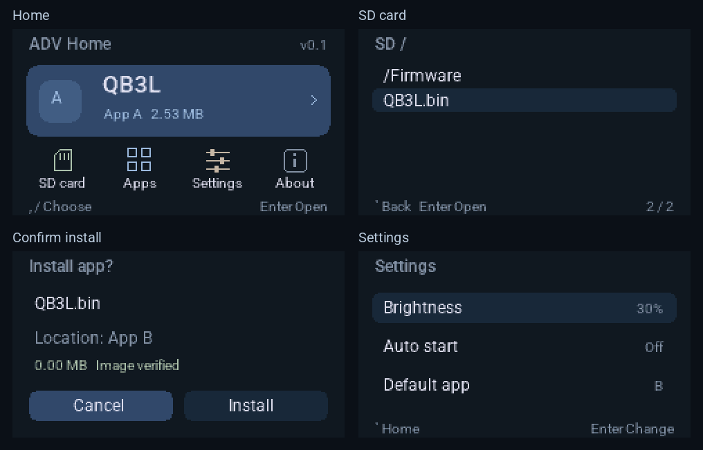

# ADV Home

[English](README.md) | **简体中文**

面向 **M5Stack Cardputer ADV / ESP32-S3 / 8 MB Flash** 的轻量启动器。设备显示 **v0.1**，对应 Git 标签 **v0.1.0**。英文界面使用 Roboto，正文采用 Regular，标题采用 Medium。

预览由实际界面代码的帧缓冲生成。

## 功能

- 浏览 TF 卡和子目录，检查并安装兼容的 ESP32-S3 固件。
- 管理两个应用位置 A / B，每个 3 MiB，支持运行、替换和移除。
- 设置默认应用、3 秒自动启动倒计时，以及屏幕亮度。
- 倒计时期间按任意键停留在 Home；异常复位时跳过自动启动。
- 安装前验证镜像格式、芯片、校验和及附加 SHA-256；安装后读回核对。
- 独立保存 Home 配置，使用一次性启动请求选择应用。

## 下载与安装

下载 [v0.1 固件包](https://github.com/fineuralab/adv-home/releases/tag/v0.1.0)，也可以[从源码构建](#构建与测试)。[安装说明](docs/INSTALL.md)包含下载模式和烧录步骤。转发独立 bin 时，请同时提供对应的 third-party-notices ZIP。

| 文件 | 烧录地址 | 适用场景 |
|---|---|---|
| ADV-Home-v0.1_0x0.bin | 0x0 | 首次安装，或从其他启动器切换 |
| ADV-Home-v0.1-update_0x10000.bin | 0x10000 | 已有 ADV Home N1 / N1.1 / N1.2，保留应用和设置更新 |

完整包会重建 Flash 内的应用位置与配置，保留 TF 卡文件。两个地址不可混用。

## 兼容范围与已知行为

- 目前针对 Cardputer ADV；原版 Cardputer 和其他开发板尚未验证。
- 单个应用最多 3 MiB，需要标准 ESP32-S3 应用镜像和应用描述。
- 可以提取不含专用文件系统分区的单应用整合包。依赖专用 FAT / SPIFFS / LittleFS、不同分区布局或设备配置的固件可能不兼容。
- 镜像校验表示格式和数据完整性通过；不提供来源签名认证，也不保证第三方应用可运行。
- 安装成功后，默认应用会切换到刚安装的位置。需要固定启动 A 时，请安装其他应用后到 Settings 重新选择 A。
- SD 子目录的返回键进入上一级；应用操作页的返回键直接进入 Home。
- 界面为英文；此版本没有在线目录、网页上传、蓝牙或中文字体。

## 按键

| 操作 | 按键 |
|---|---|
| 左 / 右 | 逗号 / 斜杠 |
| 上 / 下 | 分号 / 句号 |
| 打开 / 确认 | Enter |
| 返回 | 左上角反引号键或右上角 Backspace |
| 回到启动器 | RST 复位；若启用自动启动，在倒计时中按任意键 |

直接按方向对应的标点键，无需 Fn。应用运行后不能使用 Home 的返回键退出应用。

## 构建与测试

使用官方 **ESP-IDF v5.4.2**。随源码提供经本地裁剪的 **M5GFX 0.2.15 子集**，无需额外下载，详见[裁剪说明](docs/M5GFX-SUBSET.md)。

在已激活的 ESP-IDF 环境中，从仓库根目录运行：

~~~sh
idf.py build
python3 tools/check_stack.py --check
idf.py merge-bin -o ADV-Home-v0.1_0x0.bin -f raw
python3 tools/verify_images.py --full build/ADV-Home-v0.1_0x0.bin --app build/adv-home.bin
python3 tools/make_release.py --build build --out dist
~~~

**sdkconfig** 为当前版本的构建配置，目标已设为 esp32s3。完整镜像由引导、分区表、Home 和默认配置合并生成；工具不会访问或烧录设备。

本机安装 Python 3.9+、Clang / Clang++ 后，可以独立运行核心和引导测试：

~~~sh
python3 tools/test.py
python3 tools/test_bootloader.py
~~~

测试生成自己的镜像样本，启用 ASan / UBSan，输出位于被 Git 忽略的 **build-host/**。重新生成字体或预览时才需要 Pillow；已有字体数据可直接构建。

更多说明见 [开发与发布](docs/DEVELOPMENT.md)。仓库附带 GitHub Actions 配置，最新运行结果见 [Actions 页面](https://github.com/fineuralab/adv-home/actions)。

## 验证状态

- 工程已有 ESP-IDF 构建、镜像和分区检查、安装事务、错误提示、自动启动以及实际引导入口的主机测试。
- N1.1 已有一台 Cardputer ADV 的安装成功反馈，包括 QB3L 安装。
- 更多设备、不同 TF 卡、全部第三方应用以及异常断电场景仍需继续验证。成功反馈不代表广泛兼容。

详见 [v0.1 发布说明](docs/releases/v0.1.0.md)。

## 源码与许可证

本工程的应用逻辑、镜像检查、安装事务、界面和启动选择策略为独立实现。底层使用 ESP-IDF、M5GFX 及其所包含的第三方代码和字体。

原创应用代码与工具采用 [MIT](LICENSE)；自定义引导适配文件采用 Apache-2.0；字体和第三方组件保留各自许可。完整来源与许可位置见[第三方说明](NOTICE.zh-CN.md)及[许可材料清单](docs/license-inventory.json)。发布前运行 `python3 tools/check_notices.py` 核对材料。
